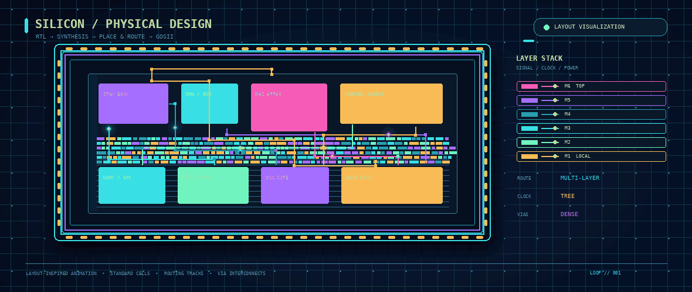

<!--
  GitHub Profile README for @icy-chidam
  Repository name must match the GitHub username: icy-chidam
  Keep assets/asic-layout-animation.gif in the same repository.
-->

  

  

  

    
    
    
    
  

  
<em>Recent ECE graduate · Building and exploring digital systems from RTL to implementation.</em>

---

## `01` — The silicon side of my work

I’m an Electronics and Communication Engineering graduate interested in **digital RTL design, FPGA prototyping, ASIC implementation, and hardware security**. I like working close to the hardware boundary: describing behaviour, structuring modules, testing corner cases, integrating interfaces, and understanding how architectural choices affect implementation.

My projects also branch into **RISC-V/SHakti systems, radar-based safety electronics, neuromorphic hardware, and lightweight embedded intelligence**. I’m currently strengthening my SystemVerilog verification discipline while continuing to build a portfolio around practical digital design.

## `02` — Animated layout / physical-design visual

  
  Custom layout-inspired animation for visual presentation — a conceptual graphic, not a project-specific GDSII screenshot or sign-off result.

## `03` — Engineering focus

  
  
  
  
  
  
  

| Domain | Topics and tools I work with or explore |
|---|---|
| **RTL & digital logic** | Verilog, SystemVerilog, FSMs, datapaths, register-mapped IP, testbenches and waveform debugging |
| **FPGA & SoC integration** | Artix-7, peripheral interfaces, UART/SPI, AXI4-Lite, SHAKTI/RISC-V-based systems |
| **ASIC implementation** | Synthesis, timing concepts, physical-design stages, OpenLane, Sky130 and RTL-to-GDSII workflows |
| **Embedded / applied hardware** | C, Python, sensor integration, radar-based detection, logging and control |
| **Exploration areas** | Hardware security, compact neural/SNN architectures, low-resource digital systems |

## `04` — Featured repositories

  
  
  
  

### A few projects beyond the repository cards

- **Tiny Secure Telemetry Engine** — a TinyTapeout digital-design project exploring telemetry-oriented data handling, PRNG generation, CRC-8 and key-stir logic.
- **SHAKTI-based Proximity Warning System** — a team-built radar/FPGA/SoC demonstrator combining mmWave sensing, zone- and speed-aware response logic, local alerts and event logging as part of the C2S / Digital India RISC-V (DIR-V) Grand Challenge.
- **Spiking Neural Network ASIC prototype** — a compact LIF-network RTL exploration using a Sky130/OpenLane-oriented implementation flow, configurable weights, stochastic input encoding and activity-aware control ideas.
- **Drift-Sense** — a wafer-inspection navigation-error recovery concept developed with my team and selected as a finalist in the SEMICON 2026 / i4C hackathon.
- **8-bit symmetry detector** — a Verilog design comparing mirrored input-bit pairs and reporting symmetry and mismatch count.

  

## `05` — GitHub activity

  
  

  

  

## `06` — Contribution snake

  <picture>
    <source media="(prefers-color-scheme: dark)" srcset="https://raw.githubusercontent.com/icy-chidam/icy-chidam/output/github-snake-dark.svg" />
    <source media="(prefers-color-scheme: light)" srcset="https://raw.githubusercontent.com/icy-chidam/icy-chidam/output/github-snake.svg" />
    
  </picture>
  This animation is generated from the real GitHub contribution graph by the included GitHub Actions workflow.

## `07` — What I’m building toward

- More rigorous **SystemVerilog verification**: self-checking testbenches, assertions, constrained-random fundamentals and functional coverage.
- Better command of **synthesis and timing**: constraints, critical paths, area/timing trade-offs and implementation reports.
- Reusable digital IP with clear interfaces, test plans and reproducible implementation steps.
- Efficient digital architectures at the intersection of **secure hardware, edge sensing and neuromorphic computation**.

## `08` — Connect

I’m open to conversations with digital-design engineers, hardware teams, researchers and collaborators working in **RTL design, FPGA development, digital ASIC implementation, physical design and hardware security**.

  
  
    
  <strong>Build carefully. Verify rigorously. Understand the silicon.</strong>

